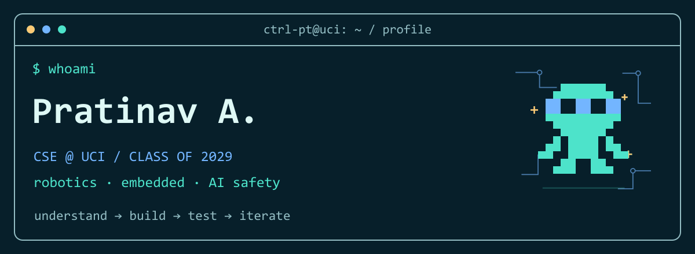
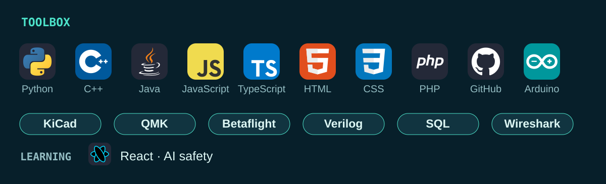
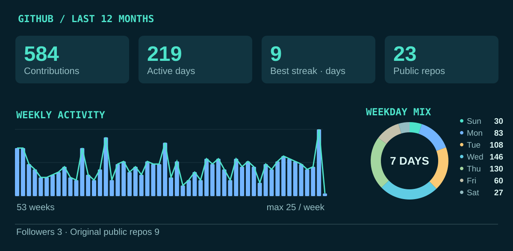
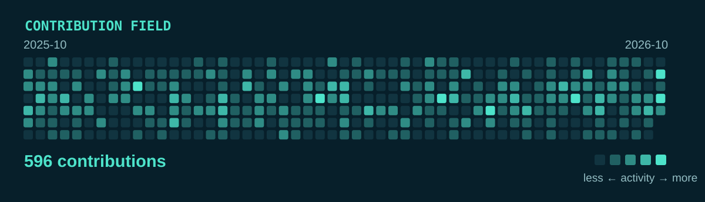
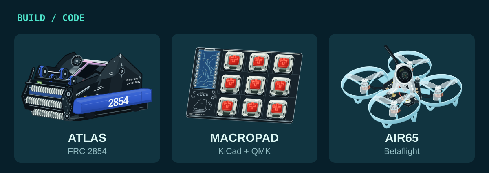
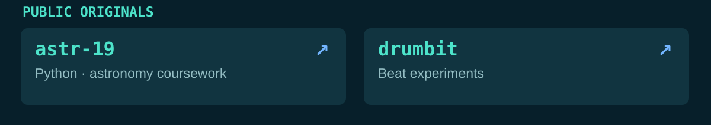
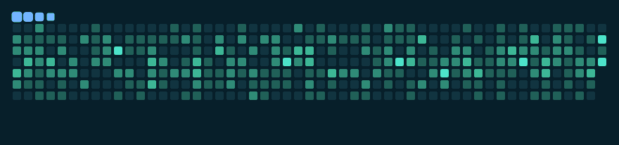

<a href="https://ctrl-pt-interactive-profile.silkypeach6.chatgpt.site/#terminal">
<picture>
  <source media="(max-width: 600px) and (prefers-reduced-motion: reduce)" srcset="./assets/readme/hero-mobile.svg">
  <source media="(prefers-reduced-motion: reduce)" srcset="./assets/readme/hero.svg">
  <source media="(max-width: 600px)" srcset="./assets/readme/hero-mobile.gif">
  
</picture>
</a>

<b>UCI CSE ’29</b> · Robotics · Embedded systems · AI safety

<a href="https://github.com/ctrl-pt?tab=repositories">Code ↗</a> · <a href="https://pratinaa.github.io/">Portfolio ↗</a> · <a href="mailto:agrawalptnv@gmail.com">Email ↗</a>

<picture>
  <source media="(max-width: 600px)" srcset="./assets/readme/stack-mobile.svg">
  
</picture>

<picture>
  <source media="(max-width: 600px)" srcset="./assets/readme/stats-mobile.svg">
  
</picture>

<picture>
  <source media="(max-width: 600px)" srcset="./assets/readme/calendar-mobile.svg">
  
</picture>

<a href="https://pratinaa.github.io/">
<picture>
  <source media="(max-width: 600px)" srcset="./assets/readme/builds-mobile.svg">
  
</picture>
</a>

<picture>
  <source media="(max-width: 600px)" srcset="./assets/readme/repositories-mobile.svg">
  
</picture>

<a href="https://github.com/ctrl-pt/astr-19">astr-19 ↗</a> · <a href="https://github.com/ctrl-pt/drumbit">drumbit ↗</a>

<a href="https://ctrl-pt-interactive-profile.silkypeach6.chatgpt.site/#snake">
<picture>
  <source media="(prefers-reduced-motion: reduce)" srcset="./assets/readme/snake-static.svg">
  
</picture>
</a>
